# PCM — Python Connection Manager

<p align="center">
  <strong>The Linux alternative to MobaXterm</strong><br>
  All-in-one remote connection manager: SSH, SFTP, FTP, RDP, VNC, Telnet, Mosh, Serial & Cloud/Containers.<br>
  Built with Python & GTK3 with native VTE terminal. Runs seamlessly on <strong>Wayland and X11</strong> without XWayland.
</p>

<p align="center">
  <a href="#english"><b>🇬🇧 English</b></a> &nbsp;•&nbsp; <a href="#italiano"><b>🇮🇹 Italiano</b></a>
</p>

<p align="center">
  <a href="EUPL-1.2%20EN.txt"></a>
  <a href="https://www.python.org/"></a>
  <a href="https://docs.gtk.org/gtk3/"></a>
  <a href="#wayland"></a>
  <a href="#quick-start"></a>
  <a href="https://github.com/buzzqw/Python_Connection_Manager/actions/workflows/build.yml"></a>
  <a href="https://github.com/buzzqw/Python_Connection_Manager/releases/latest"></a>
  <a href="https://www.paypal.com/cgi-bin/webscr?cmd=_donations&business=azanzani@gmail.com&item_name=Support+PCM+Project"></a>
  <a href="https://ko-fi.com/buzzqw"></a>
</p>

<p align="center">
  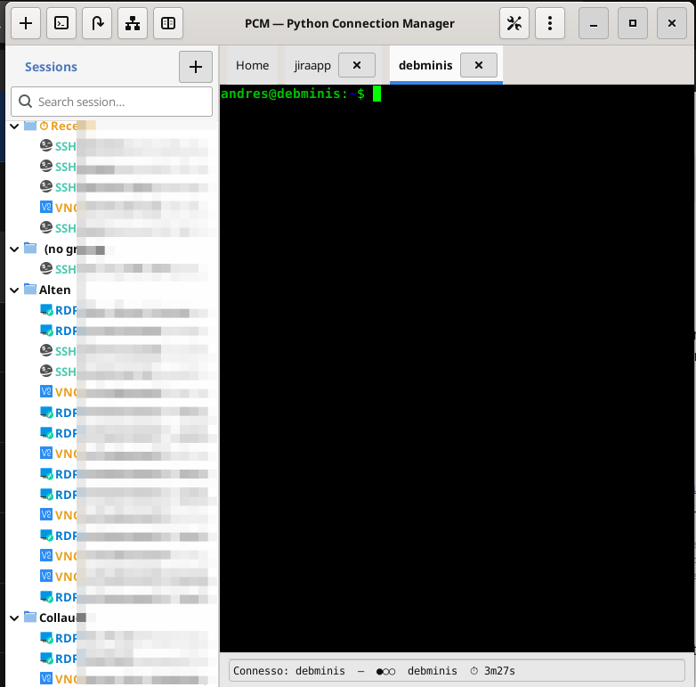
  <br>
  <em>PCM main window: hierarchical session sidebar with recent history, embedded native VTE terminal, and live connection status bar.</em>
</p>

---

<a id="english"></a>
# 🇬🇧 English

<p align="right">
  <a href="#italiano">🇮🇹 Passa alla versione Italiana</a>
</p>

> [!NOTE]
> **Single-Variant GTK3 Architecture**: PCM is engineered natively for GTK3 (PyGObject) with an integrated VTE terminal widget ([`gtk3/`](./gtk3/)). The legacy PyQt6 variant was officially retired in July 2026. Backward compatibility is fully guaranteed: PCM automatically detects, imports, and seamlessly migrates configuration profiles from older `connections.json` and `pcm_settings.json` files.

### 📑 Table of Contents

- [💡 Why PCM?](#why-pcm)
- [🚀 Quick Start & Download](#quick-start)
- [🔌 Supported Protocols & Plugins](#supported-protocols)
- [✨ Key Features](#key-features)
  - [🖥 All-in-One Protocols](#features-protocols)
  - [🔐 Enterprise-Grade Security](#features-security)
  - [📊 Real-Time Remote Monitoring Panels](#features-panels)
  - [💻 Advanced VTE Terminal Experience](#features-terminal)
  - [📁 Hierarchical Session Management](#features-sessions)
  - [🛠 Integrated DevOps & Admin Tools](#features-tools)
  - [🌍 Multilingual Interface](#features-i18n)
- [📸 Visual Showcase & Screenshots](#screenshots)
- [📦 Installation Guide](#installation)
  - [Manual Installation by Distribution](#distro-packages)
  - [Development, Testing & Linting](#development)
- [🧩 Optional Dependencies](#optional-deps)
- [⌨️ Command Line Launch & URI Handler](#cli-usage)
- [🪟 Wayland & Display Server Compatibility](#wayland)
- [⚙️ Configuration Files & Security Architecture](#config-files)
- [☕ Support the Project](#support)
- [👤 Author & License](#author-license)

---

<a id="why-pcm"></a>
## 💡 Why PCM?

| Feature / Capability | PCM | MobaXterm | Remmina | Asbru | mRemoteNG |
|---|---|---|---|---|---|
| **SSH with integrated terminal** | ✅ Native VTE | ✅ | ✅ VTE | ✅ xterm | ✅ |
| **RDP + VNC + SSH + FTP + Cloud in one tool** | ✅ | ✅ | partial | ✅ | ✅ |
| **Integrated SFTP/FTP browser** | ✅ dual-pane | ✅ dual-pane | partial (SFTP, single pane) | partial | ❌ |
| **Directory sync local↔remote** | ✅ | ✅ | ❌ | ❌ | ❌ |
| **SSH latency monitor in status bar** | ✅ | ❌ | ❌ | ❌ | ❌ |
| **Drag & drop upload to terminal** | ✅ | ✅ | ❌ | ❌ | ❌ |
| **Graphical SSH tunnels** | ✅ | ✅ | ❌ | ✅ | ❌ |
| **Broadcast to multiple terminals** | ✅ | ✅ MultiExec | ❌ | ✅ cluster | ❌ |
| **Live system monitor panel** | ✅ | ✅ | ❌ | ❌ | ❌ |
| **KeePassXC integration** | ✅ | ❌ | ❌ | ❌ | ❌ |
| **Native Wayland (no XWayland)** | ✅ | ❌ Windows only | partial | ❌ | ❌ Linux |
| **Password NEVER on command line** | ✅ autotyped into terminal | ✅ | ❌ | ⚠️ expect | — |
| **Session restore on startup** | ✅ | ✅ | ❌ | partial | ✅ |
| **TOTP / 2FA auto-type** | ✅ | ❌ | ❌ | ❌ | ❌ |
| **Template inheritance** | ✅ | ❌ | ❌ | ❌ | ✅ |
| **SSH gateway (SFTP/Telnet/RDP/VNC/SPICE)** | ✅ | ✅ | ❌ | ❌ | ❌ |
| **Plugin architecture** | ✅ | ✅ plugins | ✅ plugins | ❌ | ❌ |
| **Cloud protocols (AWS/k8s/Docker)** | ✅ plugin | ❌ | ❌ | ❌ | ❌ |
| **SPICE / KVM** | ✅ plugin | ❌ | ✅ plugin | ✅ | ❌ |
| **Tags + filter** | ✅ | ❌ | ❌ | ❌ | ❌ |
| **Password generator** | ✅ | ❌ | ❌ | ❌ | ❌ |
| **Command line launch (URI)** | ✅ | ❌ | ✅ | ❌ | ❌ |
| **Human-readable config** | ✅ JSON | ❌ proprietary | INI (.remmina) | YAML | XML |
| **Target Platforms** | Linux / FreeBSD | Windows only | Linux | Linux | Windows |
| **Software License** | EUPL-1.2 | Proprietary | GPL-2 | GPL-3 | GPL-2 |

> The comparison reflects the built-in features of each tool as far as I know them, without third-party plugins or scripts. If something is wrong or outdated, please [open an issue](https://github.com/buzzqw/Python_Connection_Manager/issues) and I will fix it.

---

<a id="quick-start"></a>
## 🚀 Quick Start & Download

The latest pre-built binaries and packages are available on [**GitHub Releases**](https://github.com/buzzqw/Python_Connection_Manager/releases/latest).

| Package / Format | Target Systems | Installation / Usage |
|---|---|---|
| **AppImage** (`PCM-*-x86_64.AppImage`) | Any modern 64-bit Linux | Portable standalone binary. Zero installation needed. Requires `libgtk-3-0` + `libvte-2.91-0`. |
| **`.deb` Package** | Debian, Ubuntu, Linux Mint, Pop!_OS | Native package with desktop integration and dependencies (`sudo apt install ./PCM-*.deb`). |
| **Source Archive** (`.tar.gz` / `.zip`) | Any Linux distribution / FreeBSD | Full source repository package ready for local execution or packaging. |

### Option 1: AppImage (Fastest & Zero Setup)

Download the AppImage, make it executable, and launch:

```bash
chmod +x PCM-*-x86_64.AppImage
./PCM-*-x86_64.AppImage
```

> [!TIP]
> Session profiles and settings are stored in `~/.config/pcm/` and are fully preserved across AppImage updates.

### Option 2: Run from Source (Automated Setup)

Clone the repository and run the setup script to install dependencies and create the application menu launcher:

```bash
git clone https://github.com/buzzqw/Python_Connection_Manager.git
cd Python_Connection_Manager
bash setup.sh
cd gtk3
python3 PCM.py
```

> The `setup.sh` script automatically detects your distribution (Debian/Ubuntu, Arch, Fedora, RHEL/AlmaLinux, openSUSE, FreeBSD) and installs the required system libraries and Python packages.

```bash
# Check installed and missing dependencies without modifying the system:
bash setup.sh --check
```

---

<a id="supported-protocols"></a>
## 🔌 Supported Protocols & Plugins

```text
SSH · SFTP · FTP/FTPS · RDP · VNC · Telnet · Mosh · Serial · Exec · SSH Tunnel · SPICE · AWS SSM · Kubectl · Docker
```

> [!TIP]
> **Extensible Plugin System**: Cloud, container, and virtualization protocols are implemented via an isolated plugin architecture. Built-in plugins reside in `gtk3/plugins/builtins/` (AWS SSM, kubectl exec, Docker containers, SPICE). User-installed community plugins go in `~/.local/share/pcm/plugins/`. For optimal security, external plugins require explicit user approval on first load and are automatically re-verified if their SHA-256 fingerprint changes.

---

<a id="key-features"></a>
## ✨ Key Features

<a id="features-protocols"></a>
### 🖥 All-in-One Protocols

| Protocol | How it opens | Strengths & Capabilities |
|---|---|---|
| **SSH** | Internal VTE tab or external terminal | Jump Host, X11 forwarding, Agent Forwarding (`-A`), VPN pre-commands, macros |
| **SFTP** | Integrated dual-pane browser | Drag & drop, transfer queue with progress/speed/ETA, rename, **directory sync local↔remote** |
| **FTP / FTPS** | Integrated browser or file manager | Explicit TLS, PASV mode, multi-directory navigation |
| **RDP** | Internal panel or external window | `xfreerdp3` / `xfreerdp` / `rdesktop`, multi-monitor, dynamic scaling, clipboard sharing |
| **VNC** | Native `gtk-vnc` or external client | Responsive scaling, pointer/keyboard grab, instant screenshots |
| **Telnet** | Internal VTE tab | Clean embedded terminal session |
| **Mosh** | Internal VTE tab | Resilient to network roaming, mobile connections, and high-latency drops |
| **Serial** | Internal VTE tab | Hardware console access with configurable baud, data bits, parity, stop bits |
| **Exec** | Internal VTE tab | Execute any custom local shell command or script in a dedicated tab |
| **SSH Tunnel** | Background, managed graphically | Dynamic SOCKS (`-D`), Local forwarding (`-L`), Remote forwarding (`-R`) |
| **SPICE** | External client (`spicy` / `remote-viewer`) | KVM/QEMU virtual machine display with TLS and audio support |
| **AWS SSM** | Internal VTE tab | Direct session into EC2 instances without open incoming SSH ports; configurable region & AWS profile |
| **Kubectl Exec** | Internal VTE tab | Direct shell into Kubernetes pods with namespace and container selection |
| **Docker Container** | Internal VTE tab | Interactive exec or attach to local and remote Docker containers |

---

<a id="features-security"></a>
### 🔐 Enterprise-Grade Security

- **Password Never Exposed on Command Line**: PCM types the password directly into the terminal pseudo-terminal (PTY) when the remote server challenges for authentication, mimicking manual user input. No `sshpass` dependency, zero plaintext arguments visible in `ps aux` or process trees.
- **Secure SSH_ASKPASS Fallback (OpenSSH ≥ 8.4)**: The askpass helper script is generated in a private runtime directory (`~/.cache/pcm/`, permissions `0700`, never in shared `/tmp`) and purged immediately upon connection establishment. Passwords are transmitted strictly via process environment variables, never written to disk.
- **RDP & VNC Credential Hygiene**: External RDP passwords pass via environment variables (never command-line flags). Temporary VNC password files reside exclusively in `~/.cache/pcm/` with `0600` permissions.
- **`known_hosts` Preservation**: Accepting a new SSH host key appends it cleanly to `~/.ssh/known_hosts` without corrupting or overwriting existing entries.
- **Hardened Configuration Exports**: Profile JSON backups omit passwords and TOTP secrets by default; exported files are created with strict `0600` file permissions.
- **Command Injection Protection**: All session parameters (hostname, port, username, device path) are sanitized with `shlex.quote()` before shell invocation. Pre-commands execute safely with `shell=False`.
- **Protected Storage Files**: `connections.json`, `pcm_settings.json`, and `audit_log.json` are created with `0600` permissions (readable and writable solely by the file owner).
- **Opt-in Strict Host Key Verification**: Newly generated profiles leave strict host key checking disabled by default; verification against `known_hosts` can be toggled globally or per profile. The integrated SFTP browser enforces Paramiko `RejectPolicy` when strict checking is enabled.
- **AES-128 Encryption (Fernet + PBKDF2-SHA256, 480k Iterations)**: Usernames, passwords, and private secrets in `connections.json` are encrypted using a master password. Decryption keys reside purely in memory and never touch the disk. Decryption integrity is validated via a randomized canary token to prevent offline dictionary attacks.
- **Cryptographic Audit Log with Hash Chaining**: Every connection event records the SHA-256 hash of the preceding entry, providing tamper-evident tracking against accidental modification.
- **Native KeePassXC Integration**: Authenticate seamlessly via KeePassXC Browser Protocol v2 (NaCl box) — search, resolve, and autofill credentials directly from your open KeePassXC vault without any browser extension.
- **Integrated SSH Keypair Management**: Generate ed25519 or RSA keypairs, inspect public keys, and deploy keys to remote servers directly from the UI.
- **SSH Agent Forwarding (`-A`)**: Propagates local `ssh-agent` keys across multi-hop bastion hosts without copying private keys to remote servers.
- **Integrated TOTP / 2FA Authenticator (RFC 6238)**: Built-in two-factor authentication token generator. Securely stores the secret key, automatically generates valid 6-digit TOTP codes, and autotypes them into terminal challenges following password entry. Fully compatible with Google Authenticator, Authy, and `otpauth://` URIs.
- **Secure Password Generator**: Dedicated 🎲 generator in session dialogs: produce cryptographically random passwords across 4 entropy tiers (16, 20, 32, 48 characters) or memorable passphrases (4 words + number), complete with real-time bit-entropy evaluation.

---

<a id="features-panels"></a>
### 📊 Real-Time Remote Monitoring Panels (Right Sidebar)

Available for SSH, VNC (Linux) and RDP (Windows) sessions, configurable per-session in the **Panels tab** of the session dialog. Opens alongside the terminal without a new window. The tab shows only the sections relevant to the selected protocol.

| Section | What it shows & Monitors |
|---|---|
| **System Overview** | CPU % (progress bar) and RAM usage (used / total), refreshed every 2 seconds |
| **Running Processes** | Sortable table (click any column header: PID, CPU%, Mem%, Command) with a dedicated kill button per process |
| **Disk Usage** | One card per partition: mount point, filesystem device, used/total, free space, visual usage bar |
| **Network Usage** | Download and upload bandwidth per second with real-time dual-line sparkline (60-sample sliding window), network interface selector |
| **Streaming Logs** | Live `journalctl` or `tail -f` stream viewer with regex filtering, log-level highlighting, and auto-scroll (hidden on Windows) |

**Protocol Support Matrix**:
- **SSH / Mosh**: Full panel suite (integrated SFTP browser + system metrics monitor).
- **VNC (Linux)**: Integrated SFTP browser + SSH monitor panel with customizable SSH management port.
- **RDP (Windows)**: Integrated SFTP browser + PowerShell-based system monitor over OpenSSH (logs tab hidden).
- **FTP, Telnet, Serial, Exec**: Informational display (no background monitor needed).

> [!NOTE]
> The monitoring panel multiplexes telemetry over the active SSH channel — zero additional TCP connections or extra credentials required. Each panel section can be toggled on or off individually per profile.

---

<a id="features-terminal"></a>
### 💻 Advanced VTE Terminal Experience

- **Native VTE Engine**: Zero X11 dependencies, flawless Wayland rendering, high refresh rates, and smooth scrolling.
- **Split View Layouts**: Split any terminal horizontally or vertically to monitor multiple systems side-by-side in a single window.
- **Designer Color Themes**: Dracula, Nord, Gruvbox, Solarized Dark/Light, One Dark, Monokai, Cobalt, Tomorrow Night, and more.
- **Per-Session Macros**: Send frequently used administration commands with one click directly from the session sidebar.
- **Global Snippet Library**: Centrally managed command snippets accessible via right-click ("Insert snippet…") or the Tools menu.
- **Terminal Broadcast (Cluster Mode)**: Type into one master input and broadcast commands across all selected terminals simultaneously.
- **Sequential Multi-Exec**: Execute a batch command across multiple saved sessions in sequence with error handling.
- **Font Zoom Controls**: <kbd>Ctrl</kbd> + Mouse Wheel, or <kbd>Ctrl+`+`</kbd> / <kbd>Ctrl+`-`</kbd> to zoom in/out; <kbd>Ctrl+`0`</kbd> to reset font size.
- **Rich Context Menu**: Select all, copy entire scrollback, save output to file, view command history, clear/reset terminal, toggle read-only mode.
- **Interactive Command History**: Filterable list of all commands dispatched in the current tab, with one-click replay.
- **Debounced Regex Search**: Search terminal output with full regular expressions, real-time match counter, and instant navigation.
- **Bracketed Paste Protection**: Multi-line pasted text is enclosed safely to prevent accidental immediate execution.
- **Copy-on-Select (Optional)**: Highlighting text automatically copies it to the system clipboard (Settings → Terminal), ready to paste with <kbd>Ctrl+V</kbd>.
- **Live SSH Latency Indicator**: Displays real-time round-trip latency (ms) in the status bar (multiplexed SSH channel or TCP probe).
- **Drag & Drop File Upload**: Drag files directly onto the terminal tab to upload them to the remote directory; drag remote files to insert their path.
- **Smart Link & Path Actions**: <kbd>Ctrl</kbd> + click URLs to open your default browser, remote file paths to edit in SFTP, or local paths in your file manager; auto-detects current remote working directory via OSC 7.
- **Activity & Bell Notifications**: Visual dot badge on background tabs receiving output, desktop notifications on terminal bell when unfocused, dynamic remote tab titles (OSC 0/2).
- **Productivity Shortcuts**: <kbd>Ctrl+Shift+A</kbd> select all, <kbd>Ctrl+Shift+S</kbd> save output, <kbd>Ctrl+Shift+K</kbd> clear screen, <kbd>Ctrl+Shift+R</kbd> reset terminal.
- **Session Output Logging**: Automatic recording of terminal sessions to disk via `script(1)`.
- **Configurable Scrollback**: Choose between standard line limits or infinite scrollback buffer.
- **Local Pre-Command Hooks**: Automatically execute local scripts (e.g. establish a VPN or mount a network volume) prior to opening a connection.

---

<a id="features-sessions"></a>
### 📁 Hierarchical Session Management

- **Hierarchical Group Organization**: Tree-based sidebar with search-as-you-type filtering.
- **Nested Folder Hierarchies**: Use `/` in group names (e.g. `Datacenter/Milan/Database`) to build visual tree structures without altering the flat JSON format.
- **Multi-Tag Categorization**: Tag profiles (e.g. `prod`, `database`, `critical`) and filter instantly using the tag combobox.
- **Template Inheritance System**: Configure master templates and derive child sessions that inherit all network, security, and UI properties while allowing granular overrides (with cyclic inheritance protection).
- **Visual Session Indicators**: Real-time green status indicator (●) beside profiles with an active connection.
- **Recent Sessions History**: Fast-access top section displaying the last 20 connected sessions with timestamps.
- **Quick Connect Toolbar**: Connect instantly to `user@host:port` directly from the main toolbar without saving a permanent profile.
- **Rich Context Actions**: Double-click to connect; right-click context menu offering duplicate, edit, logs viewer, system monitor, and ping.
- **Built-in TCP Ping**: Latency and port accessibility check (ms) directly from the session sidebar before connecting.
- **SSH Gateway (Jump Host)**: Route SFTP, Telnet, RDP, VNC, or SPICE sessions through an intermediate SSH bastion with automatic dynamic tunneling.
- **Session State Restoration**: Automatically restore open session tabs and terminal layouts on the next application launch (Settings → General).
- **System Tray Integration**: Minimize to tray on close to keep active sessions alive; tray menu provides one-click access to recent and saved profiles (AppIndicator on GNOME/KDE, `Gtk.StatusIcon` fallback).
- **One-Click Script Export**: Export any session profile as an executable standalone `.sh` shell script to reopen it directly from external terminals.
- **Comprehensive Profile Importers**: Direct session import from Remmina (`.remmina`), Remote Desktop Manager (`.rdm`/`.json`), PuTTY (`~/.putty/sessions/`), OpenSSH (`~/.ssh/config`), and MobaXterm (`.mobaXterm`).
- **SSH Config Sync with Diff Preview**: Re-importing is non-destructive. Profiles imported from `~/.ssh/config` (recursive `Include` files included) are matched by alias and synchronized only on the SSH-owned fields (`HostName`, `Port`, `User`, `IdentityFile`, `ProxyJump`), while groups, tags, credentials and terminal preferences are preserved. A preview lists new, changed and removed hosts before applying the selected entries.

---

<a id="features-tools"></a>
### 🛠 Integrated DevOps & Admin Tools

- **Graphical SSH Tunnel Manager**: Start, monitor, and stop background SSH tunnels; includes a dedicated **toolbar indicator** with a quick popover menu to inspect and close tunnels instantly.
- **Centralized Snippet Library**: Global command snippets stored in `pcm_settings.json`, organized by category, with full CRUD management and one-click insertion from terminal menus.
- **Remote SFTP File Editor**: Double-click or right-click "Edit file…" in the SFTP browser to edit remote files with your configured external GUI editor (automatic background download, file watcher, and auto-upload on save); seamlessly falls back to an embedded GtkSource/GtkTextView editor.
- **Interactive Remote Cron Manager**: Right-click on any active SSH tab → "Cron Manager…" to inspect and modify remote user crontabs via an editable TreeView with add/edit/delete dialogs and `@reboot`/`@daily`/`@weekly` presets.
- **SFTP Directory Synchronization**: Bidirectional folder comparison engine (file size + modification timestamp), interactive diff preview with direction override per file, executed via the background transfer queue.
- **Real-Time SFTP Progress**: Live progress bars displaying bytes transferred, percentage, transfer rate, and ETA during uploads and downloads.
- **Embedded Local FTP/FTPS Server**: Spin up a local FTP or TLS-encrypted FTPS server via `pyftpdlib` in a single click to share files across your network.
- **Global Environment Variables**: Define `{NAME}` placeholders once in settings and reuse them dynamically across commands, profiles, and external scripts.
- **Wake-on-LAN (WoL)**: Dispatch network magic packets automatically before opening connections to wake target hardware.
- **Connection Audit Trail**: Chronological event log tracking timestamps, session durations, protocols, and status; exportable to CSV.
- **Startup Dependency Checker**: Proactive diagnostics system that verifies external binaries and libraries upon startup.
- **Configurable External Tools**: Define arbitrary external commands with custom arguments and working directories; dynamically inject `{HOST}`, `{PORT}`, `{USER}`, `{GROUP}`, and global variables (credentials intentionally excluded for security).
- **Asynchronous Network Port Scanner**: Fast, non-blocking TCP discovery scan over target IP ranges with configurable timeouts; directly convert discovered endpoints into SSH/RDP/VNC/Telnet profiles.
- **Automated Configuration Backups**: Pre-edit timestamped backups of `connections.json` and `pcm_settings.json` with user-defined retention rotation.

---

<a id="features-i18n"></a>
### 🌍 Multilingual Interface

Complete, native localization across 5 languages:
**🇮🇹 Italiano · 🇬🇧 English · 🇩🇪 Deutsch · 🇫🇷 Français · 🇪🇸 Español**  
Switch languages easily via Settings; takes full effect upon application restart.

---

<a id="screenshots"></a>
## 📸 Visual Showcase & Screenshots

### 🖥 Core Workflows

<table>
<tr>
<td width="50%" align="center">
  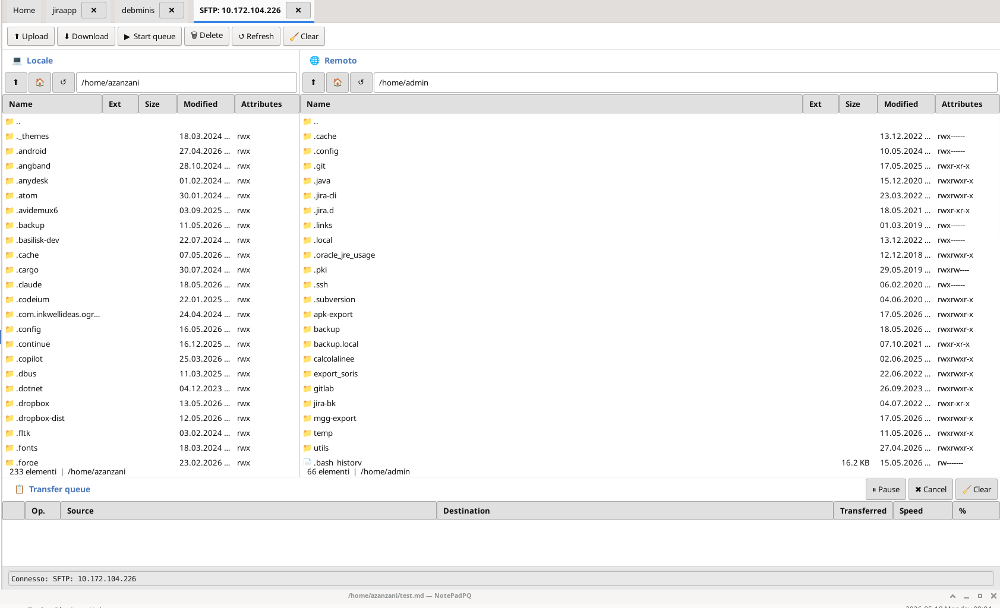
  <br>
  <b>Integrated SFTP Dual-Pane Browser</b>
  <br>
  <em>Local and remote filesystem navigation side by side, transfer queue with progress/speed/ETA, drag &amp; drop uploads, and directory synchronization.</em>
</td>
<td width="50%" align="center">
  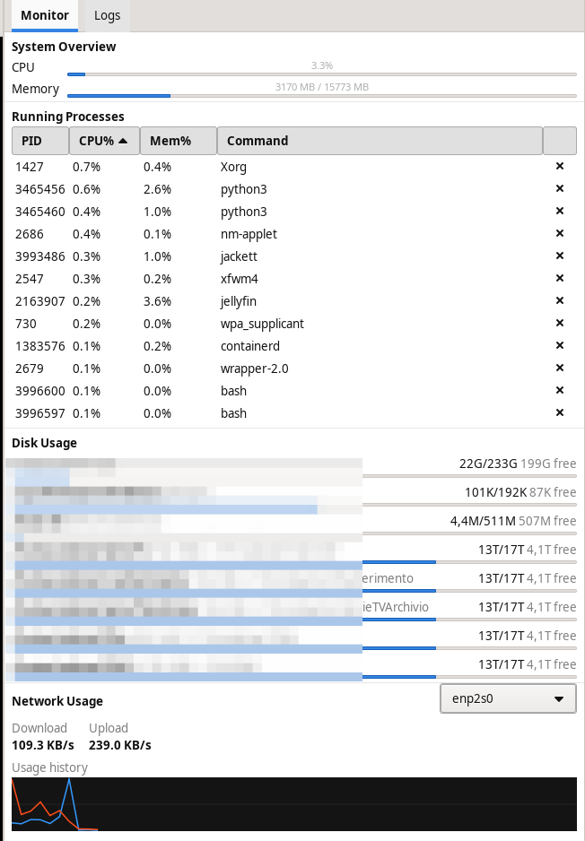
  <br>
  <b>Live SSH System Monitoring Panel</b>
  <br>
  <em>Real-time CPU and RAM utilization, interactive process table with per-process kill, partition disk usage, network traffic sparklines, and streaming journal logs.</em>
</td>
</tr>
</table>

<details>
<summary><b>🖼️ Session Configuration Dialogs (SSH, RDP, VNC, FTP, Telnet, Mosh, Serial, Exec)</b></summary>

<br>

#### SSH Connection Configuration

| | |
|---|---|
| 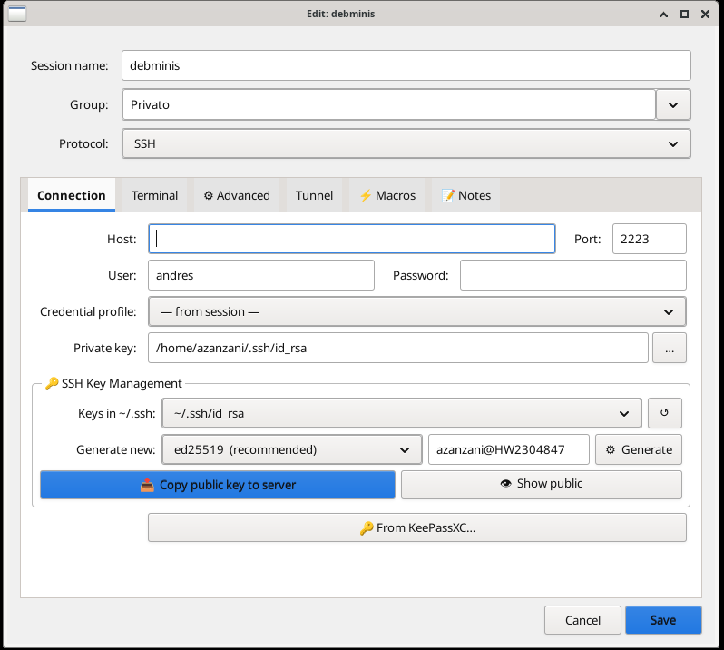 | 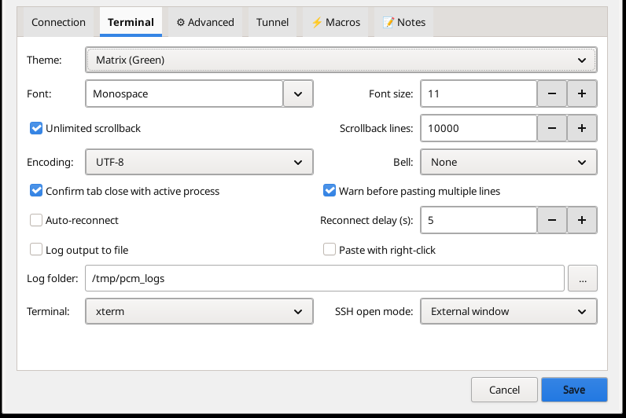 |
| *Connection tab — host, port, user, password, private key, SSH key management (generate ed25519/RSA, copy to server), KeePassXC integration* | *Terminal tab — theme, font, size, scrollback buffer, close confirmation, paste warning, file logging, SSH open mode* |
| 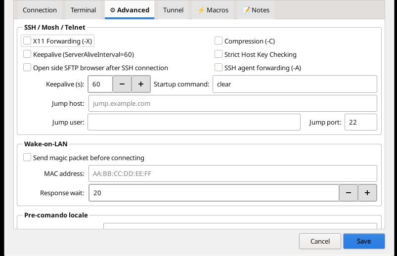 | 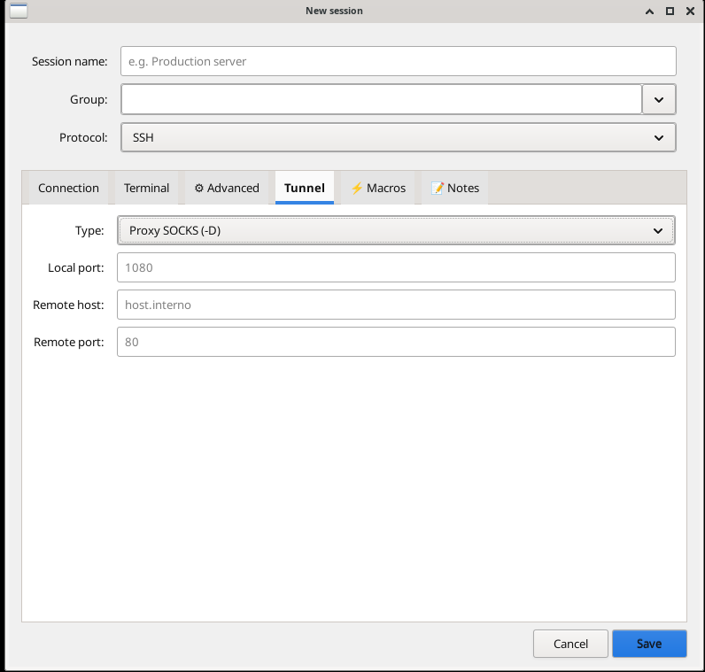 |
| *Advanced tab — X11 forwarding, compression, keepalive, strict host checking, auto-open SFTP browser, Agent Forwarding (-A), startup command, jump host, Wake-on-LAN, local pre-command* | *Tunnel tab — SOCKS proxy (-D) or port forwarding, local port, remote host and port* |
| 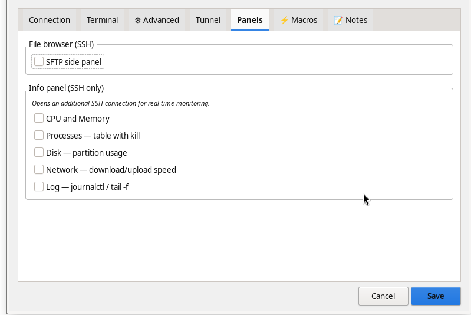 | 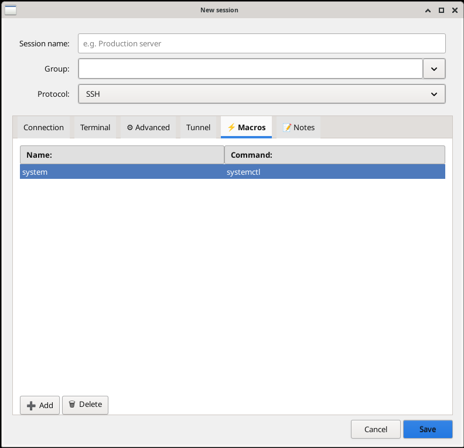 |
| *Panels tab — enable/disable per-session: SFTP side panel, Info panel sections (CPU/Memory, Processes with kill, Disk, Network sparkline, Log streaming)* | *Macros tab — per-session quick commands (name → command), sent to the terminal with one click from the sidebar* |
| 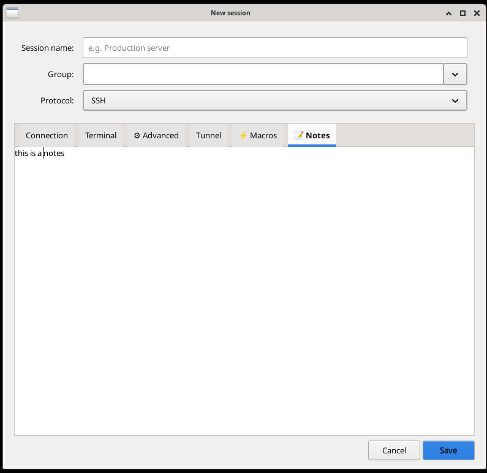 | |
| *Notes tab — free-text field for annotations attached to the session* | |

#### Remote Desktop (RDP) Configuration

| | |
|---|---|
| 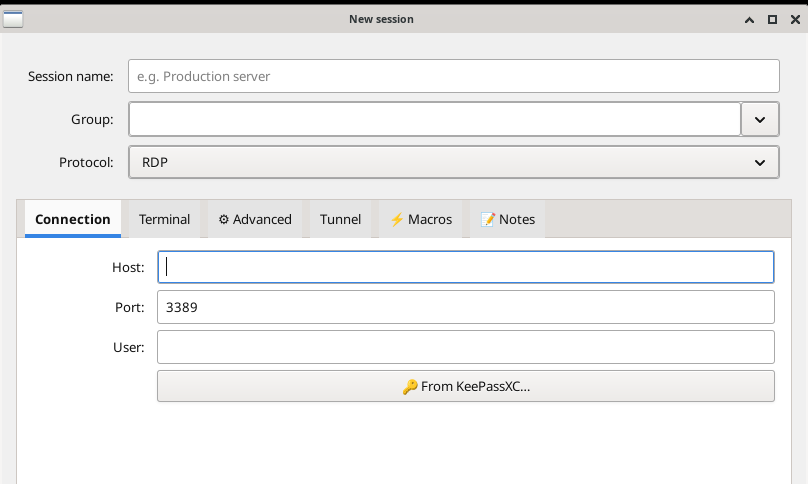 | 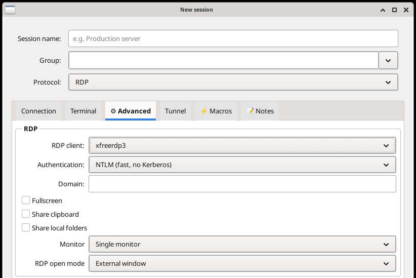 |
| *Connection tab — host, port 3389, user, KeePassXC integration* | *Advanced tab — xfreerdp3 client, NTLM/Kerberos auth, domain, fullscreen, clipboard sharing, local folder mapping, monitor selection, open mode* |

#### VNC, FTP/SFTP & Telnet Configuration

| | |
|---|---|
| 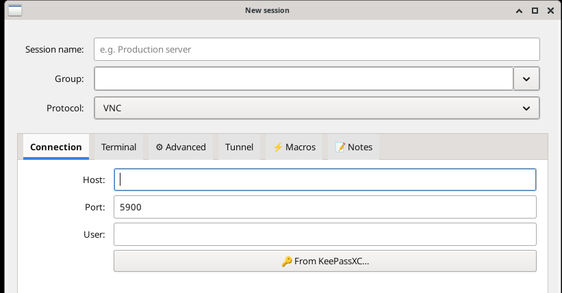 | 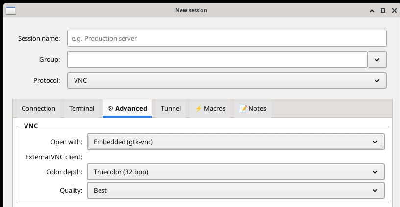 |
| *Connection tab — host, port 5900, user, KeePassXC integration* | *Advanced tab — open with embedded gtk-vnc or external client, color depth, quality* |
| 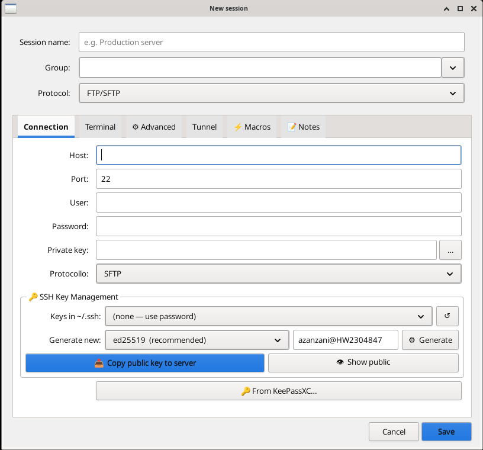 | 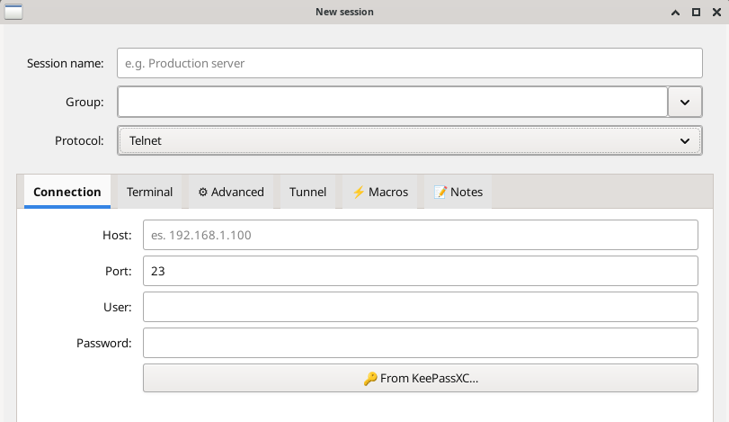 |
| *FTP/SFTP connection tab — host, port, user, password, private key, sub-protocol (SFTP/FTP/FTPS), SSH key management, KeePassXC* | *Telnet connection tab — host, port 23, user, password, KeePassXC integration* |

#### Mosh, Serial & Exec Protocol Configuration

| | |
|---|---|
| 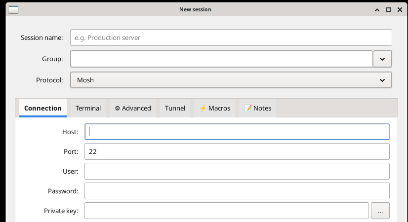 | 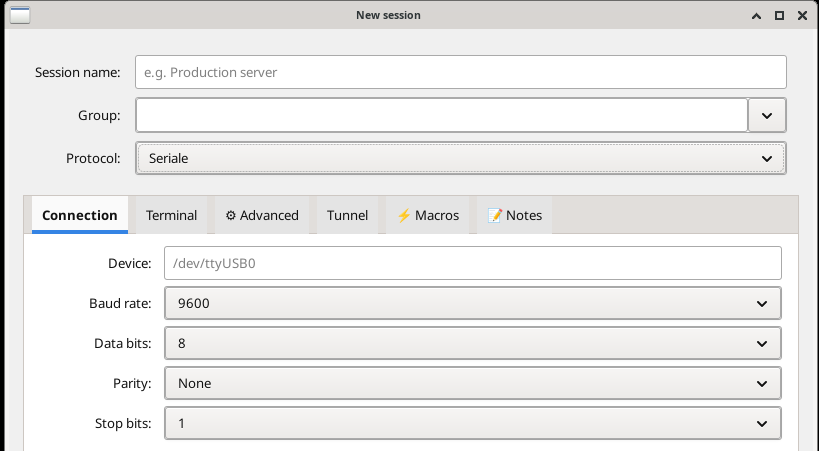 |
| *Mosh connection — host, SSH port, user, password, private key* | *Serial connection — device (/dev/ttyUSB0), baud rate, data bits, parity, stop bits* |
| 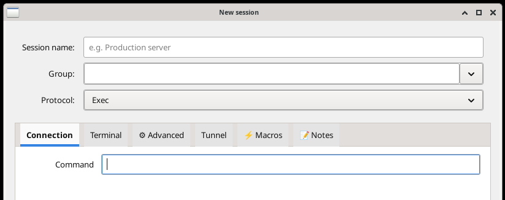 | |
| *Exec protocol — run any shell command in a dedicated VTE tab* | |

</details>

<details>
<summary><b>🛠️ Management Tools & Utilities Showcase (Tunnels, Quick Connect, KeePassXC, Imports)</b></summary>

<br>

| | |
|---|---|
| 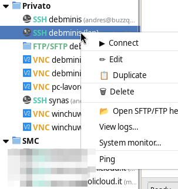 | 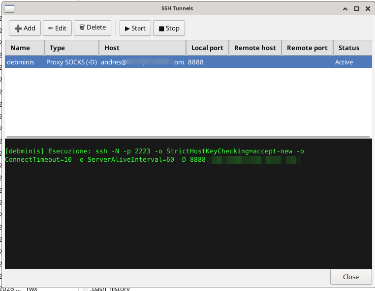 |
| *Session context menu — Connect, Edit, Duplicate, Delete, Open SFTP/FTP browser, View logs, System monitor, Ping* | *SSH Tunnel Manager — tunnel list with type, host, ports, status; Add/Edit/Delete/Start/Stop buttons; integrated output log* |
| 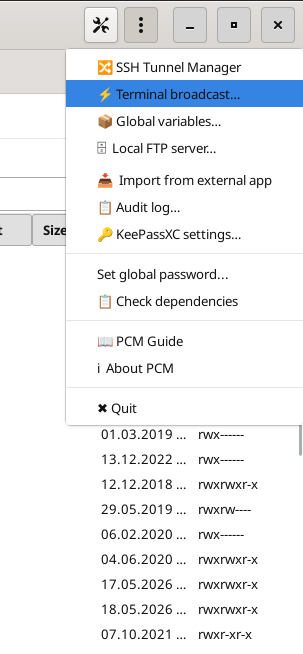 | 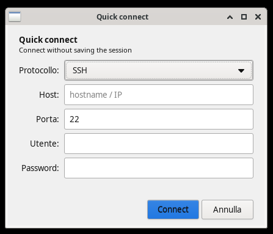 |
| *Application menu — Tunnel Manager, Broadcast, Global variables, Local FTP server, Import, Audit log, KeePassXC, Dependencies* | *Quick Connect — instant connection without saving a profile, choose protocol, host, port, user, password* |
| 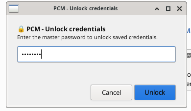 | 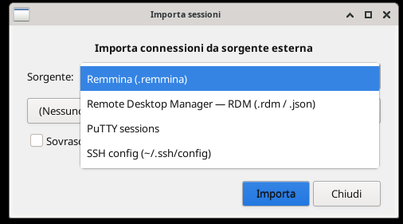 |
| *Credential unlock — master password to decrypt saved credentials (AES-128)* | *Import sessions — from Remmina (.remmina), Remote Desktop Manager (.rdm/.json), PuTTY, ~/.ssh/config, MobaXterm (.mobaXterm)* |

</details>

---

<a id="installation"></a>
## 📦 Installation Guide

<a id="distro-packages"></a>
### Manual Installation by Distribution

If you prefer installing dependencies manually via your package manager instead of running `setup.sh`:

<details>
<summary><b>Debian / Ubuntu / Linux Mint / Pop!_OS</b></summary>

```bash
sudo apt install \
    python3 python3-gi python3-gi-cairo \
    gir1.2-gtk-3.0 gir1.2-vte-2.91 gir1.2-gtk-vnc-2.0 \
    openssh-client mosh freerdp3-x11 tigervnc-viewer \
    xdotool xdg-utils wakeonlan

pip install --user cryptography paramiko pyftpdlib
```
</details>

<details>
<summary><b>Arch Linux / Manjaro</b></summary>

```bash
sudo pacman -Sy --needed \
    python python-gobject gtk3 vte3 gtk-vnc \
    openssh mosh freerdp tigervnc xdotool xdg-utils wol \
    python-cryptography python-paramiko python-pyftpdlib
```
</details>

<details>
<summary><b>Fedora</b></summary>

```bash
sudo dnf install \
    python3 python3-gobject gtk3 vte291 gtk-vnc2 \
    curl openssh-clients xdg-utils

# Optional packages
sudo dnf install freerdp mosh tigervnc xdotool gtksourceview3

pip install --user cryptography paramiko pyftpdlib pyopenssl pynacl
```
</details>

<details>
<summary><b>AlmaLinux / RHEL / Rocky Linux / CentOS Stream</b></summary>

```bash
sudo dnf install -y epel-release
sudo dnf config-manager --set-enabled crb

sudo dnf install \
    python3 python3-gobject gtk3 vte291 gtk-vnc2 \
    curl openssh-clients freerdp xdg-utils

# Optional packages (from EPEL; note EL10 availability)
sudo dnf install mosh lftp picocom gtksourceview3

python3 -m venv --system-site-packages .venv
.venv/bin/pip install "cryptography>=41.0" "paramiko>=3.0" \
    "pyftpdlib>=1.5" "pyopenssl>=23.0" "pynacl>=1.5"
```

> [!NOTE]
> On Enterprise Linux 10, `tigervnc` and `xdotool` are not in standard repositories: VNC operates natively via embedded `gtk-vnc2`, and RDP functions via `freerdp`.
</details>

<details>
<summary><b>openSUSE (Tumbleweed / Leap)</b></summary>

```bash
sudo zypper install \
    python3-gobject typelib-1_0-Gtk-3_0 \
    typelib-1_0-Vte-2.91 typelib-1_0-GtkVnc-2_0 \
    openssh mosh freerdp tigervnc xdotool xdg-utils

pip install --user cryptography paramiko pyftpdlib
```
</details>

<details>
<summary><b>FreeBSD</b></summary>

```bash
sudo pkg install \
    python3 py311-gobject gtk3 vte3 gtk-vnc \
    mosh freerdp3 tigervnc-viewer xdotool wakeonlan \
    py311-cryptography py311-paramiko py311-pyftpdlib
```
</details>

<a id="development"></a>
### Development, Testing & Linting

```bash
cd gtk3

# Run the test suite (on headless environments: xvfb-run --auto-servernum python3 -m pytest -q)
python3 -m pytest -q

# Code quality and style checking with Ruff (config: ruff.toml at repository root)
ruff check .
```

---

<a id="optional-deps"></a>
## 🧩 Optional Dependencies

| Package / Library | Enabled Functionality |
|---|---|
| `gir1.2-gtk-vnc-2.0` / `gtk-vnc` | Native embedded VNC client (recommended) |
| `tigervnc-viewer` / `xtightvncviewer` | External VNC viewer fallback |
| `freerdp3-x11` / `xfreerdp` | Remote Desktop (RDP) sessions |
| `mosh` | Mosh (Mobile Shell) sessions |
| `picocom` / `minicom` | Serial port console sessions |
| `xdotool` | RDP embedded panel mode (requires XWayland) |
| `wakeonlan` / `wol` | Wake-on-LAN magic packet dispatch |
| `keepassxc` | KeePassXC password manager integration |
| `pynacl` | KeePassXC Browser Protocol v2 NaCl encryption |
| `awscli` + `session-manager-plugin` | AWS Systems Manager (SSM) plugin |
| `kubectl` | Kubernetes Pod Shell (kubectl exec) plugin |
| `docker` | Docker Container Exec/Attach plugin |
| `spicy` / `remote-viewer` / `virt-viewer` | SPICE protocol plugin for KVM/QEMU |
| `gir1.2-ayatanaappindicator3-0.1` / `libappindicator-gtk3` | System tray icon (AppIndicator); `Gtk.StatusIcon` fallback on classic X11 |

---

<a id="cli-usage"></a>
## ⌨️ Command Line Launch & URI Handler

PCM accepts connection URIs on startup or while an instance is already running. When PCM is already active, the connection opens dynamically as a new tab in the running window without prompting again for the master password.

```bash
# Open a saved session named "jiraapp" (matched by session name, then hostname)
python3 PCM.py ssh://jiraapp

# Open an ad-hoc connection (no pre-saved session required)
python3 PCM.py ssh://admin@192.168.1.10:2222
```

Supported URI schemes:
`ssh://` &nbsp;•&nbsp; `rdp://` &nbsp;•&nbsp; `vnc://` &nbsp;•&nbsp; `sftp://` &nbsp;•&nbsp; `ftp://` &nbsp;•&nbsp; `ftps://` &nbsp;•&nbsp; `telnet://` &nbsp;•&nbsp; `mosh://`

> For full syntax details, options, and comprehensive examples, open **Help → PCM Guide** inside the application or consult the [manual page](gtk3/pcm.1.md) (`man pcm`). The guide is also viewable in your browser at [`gtk3/pcm_help_en.html`](gtk3/pcm_help_en.html).

---

<a id="wayland"></a>
## 🪟 Wayland & Display Server Compatibility

GTK3 and the VTE terminal widget operate **natively on Wayland** without relying on XWayland.

- **Embedded VTE Terminal**: 100% native Wayland execution with crisp font rendering and smooth scrolling.
- **VNC Viewer (`gtk-vnc`)**: Runs natively under Wayland.
- **RDP Display Modes**:
  - **External window mode (default)**: Operates purely under native Wayland via FreeRDP.
  - **Internal embedded panel mode**: FreeRDP embedding uses `xdotool` and requires XWayland. For pure Wayland environments, keep RDP set to *"External window"*.
- **System Tray**: Utilizes AppIndicator / AyatanaAppIndicator on modern Wayland desktop environments (GNOME with AppIndicator extension, KDE Plasma). Legacy `Gtk.StatusIcon` fallback is only engaged on X11 environments that support it, ensuring windows are never hidden if the tray icon cannot be displayed.

---

<a id="config-files"></a>
## ⚙️ Configuration Files & Security Architecture

| File / Directory | Location & Permissions | Description & Security Policy |
|---|---|---|
| `connections.json` | `${XDG_CONFIG_HOME:-~/.config}/pcm/` (or repository root beside `gtk3/` in dev mode)<br>`0600` (User read/write only) | Session profiles in human-readable JSON format. Passwords and credentials encrypted with AES-128 when master password is enabled. |
| `pcm_settings.json` | Same config directory as above<br>`0600` | Global application settings, theme preferences, shortcuts, recent sessions, global snippets, global variables, and backup policies. |
| `audit_log.json` | Same config directory as above<br>`0600` | Tamper-evident connection audit trail with SHA-256 cryptographic hash chaining on each recorded session event. |
| `backups/` | Subdirectory of configuration directory<br>`0700` / `0600` | Automated pre-edit rotating backups of `connections.json` and `pcm_settings.json` adhering to retention rules. |
| `gtk3/plugins/builtins/` | Repository tree<br>Read-only | Built-in protocol plugins: AWS SSM, Kubernetes Exec, Docker Containers, and SPICE. |
| `~/.local/share/pcm/plugins/` | User data directory<br>`0700` | User-installed community plugins. Subject to explicit approval dialog and SHA-256 integrity verification. |
| `~/.local/share/pcm/logs/` | User data directory<br>`0700` | Default directory for per-session terminal session recordings (`script(1)` output logs). |
| `~/.cache/pcm/` | Private runtime cache<br>`0700` | Ephemeral runtime directory: temporary SSH_ASKPASS helper scripts (no password written to disk; passed strictly via environment), VNC password files (`0600`), and temp files for external SFTP editors. Leftovers are automatically purged at startup. |

> [!IMPORTANT]
> **AppImage Sandboxing & Persistence**: When executing from the portable AppImage, configuration files are securely stored in `${XDG_CONFIG_HOME:-~/.config}/pcm/`. All profiles, preferences, and encryption keys persist seamlessly between AppImage updates.

---

<a id="support"></a>
## ☕ Support the Project

If you find PCM valuable for your daily workflow, sysadmin duties, or development environments, consider supporting its active maintenance and evolution:

<p align="left">
  <a href="https://www.paypal.com/cgi-bin/webscr?cmd=_donations&business=azanzani@gmail.com&item_name=Support+PCM+Project"></a>
  &nbsp;
  <a href="https://ko-fi.com/buzzqw"></a>
</p>

*Every contribution helps dedicate time to new features, protocol plugins, bug fixes, and continuous improvements. Thank you!*

---

<a id="author-license"></a>
## 👤 Author & License

- **Author**: **Andres Zanzani** ([@buzzqw](https://github.com/buzzqw))
- **License**: Released under the **European Union Public Licence v1.2** ([EUPL-1.2](EUPL-1.2%20EN.txt)).
- **Repository**: [github.com/buzzqw/Python_Connection_Manager](https://github.com/buzzqw/Python_Connection_Manager)

---
---

<a id="italiano"></a>
# 🇮🇹 Italiano

<p align="right">
  <a href="#english">🇬🇧 Switch to English</a>
</p>

> [!NOTE]
> **Architettura a variante singola (GTK3)**: PCM è sviluppato nativamente con GTK3 (PyGObject) e widget terminale VTE nativo ([`gtk3/`](./gtk3/)). La precedente variante PyQt6 è stata ritirata a luglio 2026. La retrocompatibilità è garantita al 100%: PCM rileva, importa e aggiorna automaticamente le configurazioni `connections.json` e `pcm_settings.json` create con le versioni precedenti.

### 📑 Indice dei contenuti

- [💡 Perché PCM?](#it-perche-pcm)
- [🚀 Quick Start e Download](#it-quick-start)
- [🔌 Protocolli supportati e Sistema Plugin](#it-protocolli)
- [✨ Funzionalità principali](#it-funzionalita)
  - [🖥 Tutti i protocolli in un'unica finestra](#it-feat-protocolli)
  - [🔐 Sicurezza sopra la media](#it-feat-sicurezza)
  - [📊 Pannello monitor in tempo reale](#it-feat-pannelli)
  - [💻 Terminale VTE avanzato](#it-feat-terminale)
  - [📁 Gestione gerarchica delle sessioni](#it-feat-sessioni)
  - [🛠 Strumenti DevOps e amministrazione integrati](#it-feat-strumenti)
  - [🌍 Internazionalizzazione](#it-feat-i18n)
- [📸 Galleria Screenshot e Showcase](#it-screenshots)
- [📦 Guida all'installazione](#it-installazione)
  - [Installazione manuale per distribuzione](#it-distro-packages)
  - [Sviluppo, test e linting](#it-sviluppo)
- [🧩 Dipendenze opzionali](#it-dipendenze)
- [⌨️ Avvio da riga di comando e Gestore URI](#it-cli)
- [🪟 Compatibilità Wayland e Display Server](#it-wayland)
- [⚙️ File di configurazione e Architettura di sicurezza](#it-config)
- [☕ Supporta il progetto](#it-supporto)
- [👤 Autore e licenza](#it-autore-licenza)

---

<a id="it-perche-pcm"></a>
## 💡 Perché PCM?

| Funzionalità / Capacità | PCM | MobaXterm | Remmina | Asbru | mRemoteNG |
|---|---|---|---|---|---|
| **SSH con terminale integrato** | ✅ VTE nativo | ✅ | ✅ VTE | ✅ xterm | ✅ |
| **RDP + VNC + SSH + FTP + Cloud in un tool** | ✅ | ✅ | parziale | ✅ | ✅ |
| **Browser SFTP/FTP integrato** | ✅ dual-pane | ✅ dual-pane | parziale (SFTP, pannello singolo) | parziale | ❌ |
| **Sincronizzazione directory locale↔remota** | ✅ | ✅ | ❌ | ❌ | ❌ |
| **Monitor latenza SSH nella statusbar** | ✅ | ❌ | ❌ | ❌ | ❌ |
| **Upload via drag & drop nel terminale** | ✅ | ✅ | ❌ | ❌ | ❌ |
| **Tunnel SSH grafici** | ✅ | ✅ | ❌ | ✅ | ❌ |
| **Broadcast a più terminali** | ✅ | ✅ MultiExec | ❌ | ✅ cluster | ❌ |
| **Pannello monitor sistema live** | ✅ | ✅ | ❌ | ❌ | ❌ |
| **KeePassXC integrato** | ✅ | ❌ | ❌ | ❌ | ❌ |
| **Wayland nativo (no XWayland)** | ✅ | ❌ solo Windows | parziale | ❌ | ❌ Linux |
| **Password MAI sulla command line** | ✅ digitata nel terminale | ✅ | ❌ | ⚠️ expect | — |
| **Ripristino sessioni all'avvio** | ✅ | ✅ | ❌ | parziale | ✅ |
| **TOTP / 2FA auto-type** | ✅ | ❌ | ❌ | ❌ | ❌ |
| **Ereditarietà template** | ✅ | ❌ | ❌ | ❌ | ✅ |
| **SSH gateway (SFTP/Telnet/RDP/VNC/SPICE)** | ✅ | ✅ | ❌ | ❌ | ❌ |
| **Architettura plugin** | ✅ | ✅ plugin | ✅ plugin | ❌ | ❌ |
| **Protocolli cloud (AWS/k8s/Docker)** | ✅ plugin | ❌ | ❌ | ❌ | ❌ |
| **SPICE / KVM** | ✅ plugin | ❌ | ✅ plugin | ✅ | ❌ |
| **Tag + filtro** | ✅ | ❌ | ❌ | ❌ | ❌ |
| **Generatore password** | ✅ | ❌ | ❌ | ❌ | ❌ |
| **Avvio da riga di comando (URI)** | ✅ | ❌ | ✅ | ❌ | ❌ |
| **Configurazione leggibile** | ✅ JSON | ❌ proprietario | INI (.remmina) | YAML | XML |
| **Piattaforma di destinazione** | Linux / FreeBSD | solo Windows | Linux | Linux | Windows |
| **Licenza software** | EUPL-1.2 | Proprietario | GPL-2 | GPL-3 | GPL-2 |

> Il confronto riflette le funzionalità integrate di ciascun programma per quanto ne so, senza plugin o script di terze parti. Se qualcosa è sbagliato o non aggiornato, [apri una issue](https://github.com/buzzqw/Python_Connection_Manager/issues) e lo correggo.

---

<a id="it-quick-start"></a>
## 🚀 Quick Start e Download

I pacchetti di rilascio e i file binari precompilati sono disponibili su [**GitHub Releases**](https://github.com/buzzqw/Python_Connection_Manager/releases/latest).

| Pacchetto / Formato | Sistemi di destinazione | Installazione / Utilizzo |
|---|---|---|
| **AppImage** (`PCM-*-x86_64.AppImage`) | Qualsiasi Linux a 64 bit moderno | Binario portabile pronto all'uso. Nessuna installazione richiesta. Richiede `libgtk-3-0` + `libvte-2.91-0`. |
| **Pacchetto `.deb`** | Debian, Ubuntu, Linux Mint, Pop!_OS | Pacchetto nativo con integrazione menu e dipendenze (`sudo apt install ./PCM-*.deb`). |
| **Archivio sorgente** (`.tar.gz` / `.zip`) | Qualsiasi distribuzione Linux / FreeBSD | Pacchetto sorgente completo per esecuzione locale o packaging. |

### Opzione 1: AppImage (Il metodo più rapido e senza installazione)

Scarica l'AppImage, rendila eseguibile e avviala:

```bash
chmod +x PCM-*-x86_64.AppImage
./PCM-*-x86_64.AppImage
```

> [!TIP]
> I profili di sessione e le impostazioni vengono salvati in `~/.config/pcm/` e persistono automaticamente tra un aggiornamento e l'altro.

### Opzione 2: Avvio da sorgente (Configurazione automatica)

Clona il repository ed esegui lo script di configurazione per installare le dipendenze e creare la voce nel menu applicazioni:

```bash
git clone https://github.com/buzzqw/Python_Connection_Manager.git
cd Python_Connection_Manager
bash setup.sh
cd gtk3
python3 PCM.py
```

> Lo script `setup.sh` rileva automaticamente la distribuzione in uso (Debian/Ubuntu, Arch, Fedora, RHEL/AlmaLinux, openSUSE, FreeBSD) e installa le librerie di sistema e i pacchetti Python necessari.

```bash
# Verifica le dipendenze installate e mancanti senza modificare il sistema:
bash setup.sh --check
```

---

<a id="it-protocolli"></a>
## 🔌 Protocolli supportati e Sistema Plugin

```text
SSH · SFTP · FTP/FTPS · RDP · VNC · Telnet · Mosh · Seriale · Exec · SSH Tunnel · SPICE · AWS SSM · Kubectl · Docker
```

> [!TIP]
> **Sistema Plugin Estendibile**: I protocolli cloud, container e di virtualizzazione sono implementati mediante un'architettura a plugin isolata. I plugin built-in risiedono in `gtk3/plugins/builtins/` (AWS SSM, kubectl exec, container Docker, SPICE). I plugin forniti dalla community vanno collocati in `~/.local/share/pcm/plugins/`. Per garantire la massima sicurezza, i plugin esterni richiedono approvazione esplicita al primo caricamento e vengono riverificati se la loro impronta SHA-256 cambia.

---

<a id="it-funzionalita"></a>
## ✨ Funzionalità principali

<a id="it-feat-protocolli"></a>
### 🖥 Tutti i protocolli in un'unica finestra

| Protocollo | Come si apre | Punti di forza e Funzionalità |
|---|---|---|
| **SSH** | Tab VTE interno o terminale esterno | Jump Host, X11 forwarding, Agent Forwarding (`-A`), pre-comandi VPN, macro |
| **SFTP** | Browser dual-pane integrato | Drag & drop, coda trasferimenti con progresso/velocità/ETA, rinomina, **sincronizzazione directory locale↔remota** |
| **FTP / FTPS** | Browser integrato o file manager | TLS esplicito, modalità PASV, navigazione multi-directory |
| **RDP** | Pannello interno o finestra esterna | `xfreerdp3` / `xfreerdp` / `rdesktop`, multi-monitor, scaling dinamico, condivisione appunti |
| **VNC** | `gtk-vnc` nativo o client esterno | Risoluzione scalabile, cattura tastiera/mouse, screenshot istantanei |
| **Telnet** | Tab VTE interno | Sessione terminale integrata pulita |
| **Mosh** | Tab VTE interno | Resistente a roaming di rete, connessioni mobili e disconnessioni ad alta latenza |
| **Seriale** | Tab VTE interno | Accesso a console hardware con baud rate, bit dati, parità e bit di stop configurabili |
| **Exec** | Tab VTE interno | Esecuzione di qualsiasi comando shell o script locale in una scheda dedicata |
| **SSH Tunnel** | Background, gestito graficamente | SOCKS dinamico (`-D`), inoltro locale (`-L`), inoltro remoto (`-R`) |
| **SPICE** | Client esterno (`spicy` / `remote-viewer`) | Macchine virtuali KVM/QEMU con supporto TLS e audio |
| **AWS SSM** | Tab VTE interno | Connessione diretta a istanze EC2 senza porte SSH in ingresso aperte; regione e profilo AWS configurabili |
| **Kubectl Exec** | Tab VTE interno | Shell diretta nei pod Kubernetes con selezione di namespace e container |
| **Docker Container** | Tab VTE interno | Exec o attach interattivo su container Docker locali e remoti |

---

<a id="it-feat-sicurezza"></a>
### 🔐 Sicurezza sopra la media

- **Password mai sulla riga di comando**: PCM digita la password direttamente nello pseudo-terminale (PTY) quando il server remoto richiede l'autenticazione, simulando la digitazione manuale dell'utente. Nessuna dipendenza da `sshpass`, nessun argomento in chiaro visibile in `ps aux` o nella tabella dei processi.
- **Fallback sicuro con SSH_ASKPASS (OpenSSH ≥ 8.4)**: Lo script helper viene generato in una directory runtime privata (`~/.cache/pcm/`, permessi `0700`, mai nella cartella condivisa `/tmp`) e rimosso immediatamente al termine della connessione. Le password transitano esclusivamente tramite variabili d'ambiente, mai memorizzate su disco.
- **Igiene delle credenziali RDP e VNC**: La password RDP per i client esterni transita tramite ambiente (mai argomenti shell). I file temporanei delle password VNC risiedono esclusivamente in `~/.cache/pcm/` con permessi `0600`.
- **Preservazione di `known_hosts`**: L'accettazione di una nuova host key SSH la aggiunge in coda a `~/.ssh/known_hosts` senza corrompere né sovrascrivere le voci esistenti.
- **Esportazioni protette**: I backup JSON escludono password e segreti TOTP per impostazione predefinita; i file esportati vengono salvati con permessi restrittivi `0600`.
- **Protezione da Command Injection**: Tutti i parametri di connessione (host, porta, utente, device) vengono sanificati con `shlex.quote()` prima dell'uso nella shell. I pre-comandi vengono eseguiti con `shell=False`.
- **File di configurazione protetti**: `connections.json`, `pcm_settings.json` e `audit_log.json` vengono creati con permessi `0600` (leggibili e scrivibili esclusivamente dal proprietario del file).
- **Verifica host key SSH opzionale**: Nei nuovi profili `StrictHostKeyChecking` è disabilitato per impostazione predefinita; può essere attivato globalmente o per singolo profilo per convalidare gli host tramite `known_hosts`. Il browser SFTP integrato applica la policy `RejectPolicy` di Paramiko quando il controllo è attivo.
- **Cifratura AES-128 (Fernet + PBKDF2-SHA256, 480k iterazioni)**: Nomi utente, password e segreti in `connections.json` vengono cifrati tramite una master password. La chiave di decifratura risiede unicamente in RAM e non tocca mai il disco. La correttezza della decifratura è validata mediante un canary token casuale per prevenire attacchi a dizionario offline.
- **Audit log crittografico con hash chaining**: Ogni evento di connessione registra l'hash SHA-256 della voce precedente, rendendo immediatamente rilevabile qualsiasi manomissione accidentale o non sincronizzata.
- **Integrazione nativa KeePassXC**: Autenticazione diretta tramite KeePassXC Browser Protocol v2 (NaCl box) — ricerca, risoluzione e compilazione credenziali direttamente dal database aperto senza ricorrere a estensioni per browser.
- **Gestione integrata delle chiavi SSH**: Genera coppie di chiavi ed25519 o RSA, visualizza la chiave pubblica e installa la chiave sul server remoto direttamente dall'interfaccia.
- **SSH Agent Forwarding (`-A`)**: Propaga le chiavi di `ssh-agent` attraverso host bastion multi-hop senza dover copiare chiavi private su macchine remote.
- **Autenticatore TOTP / 2FA integrato (RFC 6238)**: Generatore di token a due fattori integrato. Salva in sicurezza la chiave segreta, genera codici OTP a 6 cifre e li digita automaticamente nel terminale subito dopo la password. Pienamente compatibile con Google Authenticator, Authy e URI `otpauth://`.
- **Generatore sicuro di password**: Pulsante dedicato 🎲 nei dialoghi di connessione: genera password casuali ad alta entropia su 4 livelli (16, 20, 32, 48 caratteri) o passphrase memorabili (4 parole + numero), con stima dell'entropia in bit in tempo reale.

---

<a id="it-feat-pannelli"></a>
### 📊 Pannello monitor in tempo reale (Sidebar destra)

Disponibile per sessioni SSH, VNC (Linux) e RDP (Windows), configurabile per-sessione nel **tab Pannelli** del dialogo sessione. Si apre a fianco del terminale senza aprire nuove finestre. Il tab mostra solo le sezioni rilevanti per il protocollo selezionato.

| Sezione | Cosa mostra e Monitora |
|---|---|
| **System Overview** | CPU % (barra di avanzamento) e utilizzo RAM (usato / totale), aggiornati ogni 2 secondi |
| **Running Processes** | Tabella ordinabile per colonna (PID, CPU%, Mem%, Command) con pulsante di arresto (kill) mirato per ciascun processo |
| **Disk Usage** | Una scheda per partizione: mount point, dispositivo filesystem, usato/totale, spazio libero, barra visiva di utilizzo |
| **Network Usage** | Velocità di download e upload al secondo con sparkline dinamica a doppia linea (cronologia di 60 campioni), selettore interfaccia di rete |
| **Streaming Log** | Visualizzatore in tempo reale di `journalctl` o `tail -f` con filtro regex, evidenziazione per livello e scorrimento automatico (nascosto su Windows) |

**Matrice di supporto protocolli**:
- **SSH / Mosh**: Suite completa (browser SFTP integrato + monitor metriche di sistema).
- **VNC (Linux)**: Browser SFTP integrato + pannello monitor SSH con porta di gestione SSH configurabile.
- **RDP (Windows)**: Browser SFTP integrato + monitor basato su PowerShell tramite OpenSSH (tab log nascosto).
- **FTP, Telnet, Seriale, Exec**: Display informativo (nessun monitor in background necessario).

> [!NOTE]
> Il pannello di monitoraggio riutilizza la connessione SSH già stabilita per la sessione — zero connessioni TCP aggiuntive e nessuna credenziale extra richiesta. Ogni sezione del pannello può essere attivata o disattivata individualmente per profilo.

---

<a id="it-feat-terminale"></a>
### 💻 Terminale VTE avanzato

- **Motore VTE Nativo**: Zero dipendenze X11, rendering Wayland impeccabile, frame rate elevato e scorrimento fluido.
- **Layout a schermo diviso (Split View)**: Suddividi qualsiasi terminale in orizzontale o verticale per affiancare più sessioni in un'unica finestra.
- **Temi colore accurati**: Dracula, Nord, Gruvbox, Solarized Dark/Light, One Dark, Monokai, Cobalt, Tomorrow Night e altri.
- **Macro per sessione**: Invia comandi di amministrazione frequenti con un solo clic direttamente dalla barra laterale.
- **Libreria globale di snippet**: Comandi riutilizzabili centralizzati accessibili dal menu contestuale ("Inserisci snippet…") o dal menu Strumenti.
- **Broadcast terminali (Modalità Cluster)**: Digita in un unico input e invia i comandi contemporaneamente a tutti i terminali selezionati.
- **Multi-Exec sequenziale**: Esegui un comando in sequenza su più sessioni selezionate con gestione degli errori.
- **Controllo zoom dei caratteri**: <kbd>Ctrl</kbd> + Rotella mouse, oppure <kbd>Ctrl+`+`</kbd> / <kbd>Ctrl+`-`</kbd> per ingrandire/rimpicciolire; <kbd>Ctrl+`0`</kbd> per ripristinare.
- **Menu contestuale avanzato**: Seleziona tutto, copia tutto lo scrollback, salva output su file, cronologia comandi, pulisci/reset terminale, modalità sola lettura.
- **Cronologia comandi interattiva**: Elenco filtrabile di tutti i comandi inviati nella sessione con riesecuzione in un clic.
- **Ricerca regex con debounce**: Cerca nell'output del terminale con supporto completo per espressioni regolari e contatore occorrenze in tempo reale.
- **Protezione Bracketed Paste**: Il testo incollato su più righe viene protetto per evitare l'esecuzione involontaria immediata.
- **Copia automatica su selezione (opzionale)**: Selezionando il testo con il mouse viene copiato direttamente negli appunti di sistema (Impostazioni → Terminale), pronto per <kbd>Ctrl+V</kbd>.
- **Indicatore latenza SSH live**: Mostra il tempo di round-trip in millisecondi nella barra di stato in tempo reale (canale SSH multiplexato o probe TCP).
- **Upload file tramite Drag & Drop**: Trascina file locali direttamente sul terminale per caricarli nella cartella remota corrente; trascina file remoti per incollarne il percorso.
- **Azioni intelligenti su link e percorsi**: <kbd>Ctrl</kbd> + clic per aprire URL nel browser, percorsi remoti nell'editor SFTP o percorsi locali nel file manager; rilevamento cartella remota corrente tramite OSC 7.
- **Notifiche di attività e campanello**: Pallino visivo sui tab in background che ricevono output, notifica desktop al terminal bell quando la finestra non è attiva, titoli remoti dinamici (OSC 0/2).
- **Scorciatoie di produttività**: <kbd>Ctrl+Shift+A</kbd> seleziona tutto, <kbd>Ctrl+Shift+S</kbd> salva output, <kbd>Ctrl+Shift+K</kbd> pulisci schermo, <kbd>Ctrl+Shift+R</kbd> reset terminale.
- **Registrazione sessioni su file**: Salvataggio automatico dell'output su file tramite `script(1)`.
- **Scrollback configurabile**: Possibilità di impostare il buffer su limiti numerici o su scrollback infinito.
- **Pre-comandi locali**: Esecuzione automatica di comandi locali (ad es. attivazione VPN o montaggio dischi di rete) prima dell'apertura della sessione.

---

<a id="it-feat-sessioni"></a>
### 📁 Gestione gerarchica delle sessioni

- **Organizzazione gerarchica per gruppi**: Barra laterale ad albero con filtraggio immediato search-as-you-type.
- **Gerarchie di cartelle annidate**: Utilizza `/` nei nomi dei gruppi (es. `Datacenter/Milano/Database`) per creare alberature visive mantenendo il formato JSON lineare.
- **Categorizzazione con tag multipli**: Assegna etichette ai profili (es. `prod`, `database`, `critico`) e filtra istantaneamente tramite il menu a tendina.
- **Sistema di ereditarietà template**: Configura profili template master e genera sessioni derivate che ereditano parametri di rete, sicurezza e interfaccia con possibilità di override granulare (con protezione dai riferimenti ciclici).
- **Indicatori visivi di stato sessione**: Pallino verde di stato (●) accanto alle sessioni con connessione attiva.
- **Cronologia sessioni recenti**: Sezione rapida in cima alla barra laterale con le ultime 20 connessioni recenti e relativi timestamp.
- **Toolbar Quick Connect**: Connessione immediata a `utente@host:porta` direttamente dalla barra superiore senza dover salvare un profilo.
- **Azioni contestuali complete**: Doppio clic per connettere; menu tasto destro con duplica, modifica, visualizza log, monitor di sistema e ping.
- **Ping TCP integrato**: Verifica istantanea della raggiungibilità e latenza (ms) sulla porta configurata prima di avviare la sessione.
- **Gateway SSH (Jump Host)**: Inoltro automatico di sessioni SFTP, Telnet, RDP, VNC o SPICE tramite un host bastion intermedio con creazione trasparente del tunnel.
- **Ripristino dello stato sessione**: Possibilità di ripristinare automaticamente le schede e le connessioni aperte al successivo avvio del programma (Impostazioni → Generale).
- **Integrazione System Tray**: Riduzione a icona nella barra di sistema alla chiusura per mantenere attive le connessioni; menu tray per connettersi con un clic alle sessioni recenti o salvate (AppIndicator su GNOME/KDE, fallback `Gtk.StatusIcon`).
- **Esportazione script shell**: Esporta qualsiasi sessione in uno script eseguibile autonomo `.sh` per avviarla direttamente dal terminale esterno.
- **Importazione da altri client**: Importazione diretta da profili Remmina (`.remmina`), Remote Desktop Manager (`.rdm`/`.json`), PuTTY (`~/.putty/sessions/`), OpenSSH (`~/.ssh/config`) e MobaXterm (`.mobaXterm`).
- **Sincronizzazione con SSH config e anteprima delle differenze**: Il re-import è non distruttivo. I profili importati da `~/.ssh/config` (inclusi i file `Include` ricorsivi) vengono abbinati per alias e riallineati solo sui campi gestiti da SSH (`HostName`, `Port`, `User`, `IdentityFile`, `ProxyJump`), preservando gruppo, tag, credenziali e preferenze del terminale. Un'anteprima elenca host nuovi, modificati e rimossi prima di applicare le voci selezionate.

---

<a id="it-feat-strumenti"></a>
### 🛠 Strumenti DevOps e amministrazione integrati

- **Gestore grafico dei Tunnel SSH**: Avvia, monitora e termina tunnel SSH in background; include un **indicatore nella barra degli strumenti** con popup rapido per ispezionare e arrestare i tunnel all'istante.
- **Libreria centralizzata di snippet**: Raccolta globale di comandi memorizzata in `pcm_settings.json`, suddivisa per categorie, con gestione CRUD completa e inserimento rapido dal menu del terminale.
- **Editor file SFTP remoto**: Doppio clic o clic destro "Modifica file…" nel browser SFTP per aprire file remoti con l'editor grafico predefinito (download automatico, monitoraggio modifiche in background e upload automatico al salvataggio); fallback automatico sull'editor integrato GtkSource/GtkTextView.
- **Gestore cron remoto interattivo**: Clic destro su qualsiasi tab SSH attivo → "Gestore Cron…" per consultare e modificare il crontab dell'utente remoto con una TreeView modificabile, finestre di aggiunta/modifica/eliminazione e supporto per preset `@reboot`/`@daily`/`@weekly`.
- **Sincronizzazione directory SFTP**: Motore di comparazione bidirezionale tra cartelle locali e remote (dimensione file + timestamp di modifica), anteprima interattiva dei diff con selezione della direzione per singolo file ed esecuzione tramite la coda trasferimenti.
- **Progresso SFTP in tempo reale**: Barre di avanzamento dinamiche con indicazione dei byte trasferiti, percentuale, velocità di trasferimento ed ETA stimato.
- **Server FTP/FTPS locale integrato**: Avvio con un solo clic di un server FTP o FTPS cifrato locale tramite `pyftpdlib` per condividere file in rete locale.
- **Variabili globali di ambiente**: Definisci segnaposto `{NOME}` nelle impostazioni e riutilizzali dinamicamente nei comandi, profili e script esterni.
- **Wake-on-LAN (WoL)**: Invio automatico del pacchetto magico prima di avviare la connessione per risvegliare le macchine di destinazione.
- **Registro di audit delle connessioni**: Storico dettagliato degli eventi con timestamp, durata delle sessioni, protocolli utilizzati ed esito; esportabile in formato CSV.
- **Diagnostica dipendenze all'avvio**: Verifica proattiva dei binari e delle librerie installati nel sistema all'avvio dell'applicazione.
- **Strumenti esterni configurabili**: Configura comandi esterni personalizzati con argomenti e directory di lavoro; iniezione dinamica di `{HOST}`, `{PORT}`, `{USER}`, `{GROUP}` e variabili globali (le credenziali sono escluse per sicurezza).
- **Port Scanner di rete asincrono**: Scansione TCP non bloccante su intervalli IP con timeout configurabili; conversione diretta dei nodi individuati in profili SSH, RDP, VNC o Telnet.
- **Backup preventivi automatici**: Copie di sicurezza temporizzate di `connections.json` e `pcm_settings.json` prima di ogni modifica con politica di rotazione configurabile.

---

<a id="it-feat-i18n"></a>
### 🌍 Internazionalizzazione

Supporto completo a 5 lingue native:
**🇮🇹 Italiano · 🇬🇧 English · 🇩🇪 Deutsch · 🇫🇷 Français · 🇪🇸 Español**  
Selezione della lingua dalle impostazioni di sistema; ha effetto completo al riavvio del programma.

---

<a id="it-screenshots"></a>
## 📸 Galleria Screenshot e Showcase

### 🖥 Flussi di lavoro principali

<table>
<tr>
<td width="50%" align="center">
  
  <br>
  <b>Browser SFTP integrato a doppio pannello</b>
  <br>
  <em>Navigazione file system locale e remoto affiancati, coda trasferimenti con progresso/velocità/ETA, upload via drag &amp; drop e sincronizzazione directory.</em>
</td>
<td width="50%" align="center">
  
  <br>
  <b>Pannello monitor di sistema SSH live</b>
  <br>
  <em>Utilizzo CPU e RAM in tempo reale, tabella processi interattiva con terminazione mirata, occupazione dischi per partizione, sparkline traffico di rete e streaming log journal.</em>
</td>
</tr>
</table>

<details>
<summary><b>🖼️ Dialoghi di configurazione sessione (SSH, RDP, VNC, FTP, Telnet, Mosh, Seriale, Exec)</b></summary>

<br>

#### Configurazione connessione SSH

| | |
|---|---|
|  |  |
| *Tab Connessione — host, porta, utente, password, chiave privata, gestione chiavi SSH (genera ed25519/RSA, copia sul server), integrazione KeePassXC* | *Tab Terminale — tema, font, dimensione, buffer scrollback, conferma chiusura, avviso incolla, log su file, modalità apertura SSH* |
|  |  |
| *Tab Avanzate — X11 forwarding, compressione, keepalive, strict host, SFTP browser automatico, Agent Forwarding (-A), comando di avvio, jump host, Wake-on-LAN, pre-comando locale* | *Tab Tunnel — tipo SOCKS proxy (-D) o port forwarding, porta locale, host e porta remoti* |
|  |  |
| *Tab Pannelli — abilita/disabilita per sessione: pannello SFTP laterale, sezioni Info panel (CPU/Memoria, Processi con kill, Disco, Sparkline rete, Log streaming)* | *Tab Macro — comandi rapidi per sessione (nome → comando), inviati al terminale con un clic dalla sidebar* |
|  | |
| *Tab Note — campo testo libero per annotazioni associate alla sessione* | |

#### Configurazione Remote Desktop (RDP)

| | |
|---|---|
|  |  |
| *Tab Connessione RDP — host, porta 3389, utente, integrazione KeePassXC* | *Tab Avanzate RDP — client xfreerdp3, autenticazione NTLM/Kerberos, dominio, schermo intero, condivisione appunti, cartelle locali, selezione monitor, modalità apertura* |

#### Configurazione VNC, FTP/SFTP e Telnet

| | |
|---|---|
|  |  |
| *Tab Connessione VNC — host, porta 5900, utente, integrazione KeePassXC* | *Tab Avanzate VNC — apertura con gtk-vnc integrato o client esterno, profondità colore, qualità* |
|  |  |
| *Tab Connessione FTP/SFTP — host, porta, utente, password, chiave privata, sottoprotocollo (SFTP/FTP/FTPS), gestione chiavi SSH, KeePassXC* | *Tab Connessione Telnet — host, porta 23, utente, password, integrazione KeePassXC* |

#### Configurazione protocolli Mosh, Seriale ed Exec

| | |
|---|---|
|  |  |
| *Connessione Mosh — host, porta SSH, utente, password, chiave privata* | *Connessione Seriale — dispositivo (/dev/ttyUSB0), baud rate, bit dati, parità, bit di stop* |
|  | |
| *Protocollo Exec — esegui qualsiasi comando shell in un tab VTE dedicato* | |

</details>

<details>
<summary><b>🛠️ Strumenti integrati e dialoghi di gestione (Tunnel, Quick Connect, KeePassXC, Import)</b></summary>

<br>

| | |
|---|---|
|  |  |
| *Menu contestuale sessione — Connetti, Modifica, Duplica, Elimina, Apri browser SFTP/FTP, Visualizza log, Monitor sistema, Ping* | *SSH Tunnel Manager — elenco tunnel con tipo, host, porte, stato; pulsanti Add/Edit/Delete/Start/Stop; log output integrato* |
|  |  |
| *Menu applicazione — Tunnel Manager, Broadcast, Variabili globali, Server FTP locale, Import, Audit log, KeePassXC, Dipendenze* | *Quick Connect — connessione rapida senza salvare il profilo, scelta protocollo, host, porta, utente, password* |
|  |  |
| *Sblocco credenziali — master password per decifrare le credenziali salvate (AES-128)* | *Import sessioni — da Remmina (.remmina), Remote Desktop Manager (.rdm/.json), PuTTY, ~/.ssh/config, MobaXterm (.mobaXterm)* |

</details>

---

<a id="it-installazione"></a>
## 📦 Guida all'installazione

<a id="it-distro-packages"></a>
### Installazione manuale per distribuzione

Se preferisci installare manualmente le dipendenze tramite il gestore pacchetti del tuo sistema anziché eseguire `setup.sh`:

<details>
<summary><b>Debian / Ubuntu / Linux Mint / Pop!_OS</b></summary>

```bash
sudo apt install \
    python3 python3-gi python3-gi-cairo \
    gir1.2-gtk-3.0 gir1.2-vte-2.91 gir1.2-gtk-vnc-2.0 \
    openssh-client mosh freerdp3-x11 tigervnc-viewer \
    xdotool xdg-utils wakeonlan

pip install --user cryptography paramiko pyftpdlib
```
</details>

<details>
<summary><b>Arch Linux / Manjaro</b></summary>

```bash
sudo pacman -Sy --needed \
    python python-gobject gtk3 vte3 gtk-vnc \
    openssh mosh freerdp tigervnc xdotool xdg-utils wol \
    python-cryptography python-paramiko python-pyftpdlib
```
</details>

<details>
<summary><b>Fedora</b></summary>

```bash
sudo dnf install \
    python3 python3-gobject gtk3 vte291 gtk-vnc2 \
    curl openssh-clients xdg-utils

# Pacchetti facoltativi
sudo dnf install freerdp mosh tigervnc xdotool gtksourceview3

pip install --user cryptography paramiko pyftpdlib pyopenssl pynacl
```
</details>

<details>
<summary><b>AlmaLinux / RHEL / Rocky Linux / CentOS Stream</b></summary>

```bash
sudo dnf install -y epel-release
sudo dnf config-manager --set-enabled crb

sudo dnf install \
    python3 python3-gobject gtk3 vte291 gtk-vnc2 \
    curl openssh-clients freerdp xdg-utils

# Pacchetti facoltativi (da EPEL; non tutti disponibili su EL10)
sudo dnf install mosh lftp picocom gtksourceview3

python3 -m venv --system-site-packages .venv
.venv/bin/pip install "cryptography>=41.0" "paramiko>=3.0" \
    "pyftpdlib>=1.5" "pyopenssl>=23.0" "pynacl>=1.5"
```

> [!NOTE]
> Su Enterprise Linux 10, `tigervnc` e `xdotool` non sono presenti nei repository ufficiali: VNC funziona comunque nativamente tramite `gtk-vnc2` (integrato) e RDP tramite `freerdp`.
</details>

<details>
<summary><b>openSUSE (Tumbleweed / Leap)</b></summary>

```bash
sudo zypper install \
    python3-gobject typelib-1_0-Gtk-3_0 \
    typelib-1_0-Vte-2.91 typelib-1_0-GtkVnc-2_0 \
    openssh mosh freerdp tigervnc xdotool xdg-utils

pip install --user cryptography paramiko pyftpdlib
```
</details>

<details>
<summary><b>FreeBSD</b></summary>

```bash
sudo pkg install \
    python3 py311-gobject gtk3 vte3 gtk-vnc \
    mosh freerdp3 tigervnc-viewer xdotool wakeonlan \
    py311-cryptography py311-paramiko py311-pyftpdlib
```
</details>

<a id="it-sviluppo"></a>
### Sviluppo, test e linting

```bash
cd gtk3

# Esegui la suite di test pytest (su server headless: xvfb-run --auto-servernum python3 -m pytest -q)
python3 -m pytest -q

# Controllo qualità del codice con Ruff (config: ruff.toml nella directory radice)
ruff check .
```

---

<a id="it-dipendenze"></a>
## 🧩 Dipendenze opzionali

| Pacchetto / Libreria | Funzionalità abilitata |
|---|---|
| `gir1.2-gtk-vnc-2.0` / `gtk-vnc` | Client VNC integrato nativo (raccomandato) |
| `tigervnc-viewer` / `xtightvncviewer` | Viewer VNC esterno (fallback) |
| `freerdp3-x11` / `xfreerdp` | Sessioni Remote Desktop (RDP) |
| `mosh` | Sessioni Mosh (Mobile Shell) |
| `picocom` / `minicom` | Sessioni console su porte seriali |
| `xdotool` | RDP in pannello integrato interno (richiede XWayland) |
| `wakeonlan` / `wol` | Invio pacchetti magici Wake-on-LAN |
| `keepassxc` | Integrazione con il gestore password KeePassXC |
| `pynacl` | Cifratura NaCl per KeePassXC Browser Protocol v2 |
| `awscli` + `session-manager-plugin` | Plugin AWS Systems Manager (SSM) |
| `kubectl` | Plugin shell in pod Kubernetes (kubectl exec) |
| `docker` | Plugin exec/attach su container Docker |
| `spicy` / `remote-viewer` / `virt-viewer` | Plugin protocollo SPICE per KVM/QEMU |
| `gir1.2-ayatanaappindicator3-0.1` / `libappindicator-gtk3` | Icona system tray (AppIndicator); fallback `Gtk.StatusIcon` su desktop X11 classici |

---

<a id="it-cli"></a>
## ⌨️ Avvio da riga di comando e Gestore URI

PCM accetta URI di connessione all'avvio o mentre l'applicazione è già aperta. Quando un'istanza è già attiva, la connessione viene aperta istantaneamente come nuova scheda nella finestra esistente, senza richiedere nuovamente la master password.

```bash
# Apre la sessione salvata denominata "jiraapp" (ricerca per nome sessione, poi hostname)
python3 PCM.py ssh://jiraapp

# Connessione immediata ad-hoc (non occorre salvare un profilo)
python3 PCM.py ssh://admin@192.168.1.10:2222
```

Schemi URI supportati:
`ssh://` &nbsp;•&nbsp; `rdp://` &nbsp;•&nbsp; `vnc://` &nbsp;•&nbsp; `sftp://` &nbsp;•&nbsp; `ftp://` &nbsp;•&nbsp; `ftps://` &nbsp;•&nbsp; `telnet://` &nbsp;•&nbsp; `mosh://`

> Per la sintassi completa, tutti i parametri e gli esempi, apri **Aiuto → Guida di PCM** all'interno del programma oppure consulta il [manuale](gtk3/pcm.1.md) (`man pcm`). La guida completa è consultabile anche nel browser all'indirizzo [`gtk3/pcm_help_en.html`](gtk3/pcm_help_en.html).

---

<a id="it-wayland"></a>
## 🪟 Compatibilità Wayland e Display Server

GTK3 e il widget terminale VTE funzionano in modo **completamente nativo su Wayland** senza richiedere XWayland.

- **Terminale VTE integrato**: Esecuzione 100% nativa su Wayland con rendering dei caratteri nitido e scrolling fluido.
- **Viewer VNC (`gtk-vnc`)**: Funziona nativamente sotto Wayland.
- **Modalità visualizzazione RDP**:
  - **Modalità finestra esterna (predefinita)**: Funziona interamente su Wayland puro tramite FreeRDP.
  - **Modalità pannello interno integrato**: L'incorporamento di FreeRDP tramite `xdotool` richiede XWayland. Su ambienti Wayland puri, seleziona *"Finestra esterna"*.
- **System Tray**: Utilizza AppIndicator / AyatanaAppIndicator sugli ambienti moderni Wayland (GNOME con estensione AppIndicator, KDE Plasma). Il fallback su `Gtk.StatusIcon` viene impiegato solo sui desktop X11 che lo supportano, evitando che la finestra venga nascosta se la tray icon non è visibile.

---

<a id="it-config"></a>
## ⚙️ File di configurazione e Architettura di sicurezza

| File / Cartella | Percorso e Permessi | Descrizione e Criteri di sicurezza |
|---|---|---|
| `connections.json` | `${XDG_CONFIG_HOME:-~/.config}/pcm/` (o radice repository accanto a `gtk3/` in dev)<br>`0600` (Lettura/scrittura esclusiva proprietario) | Profili di sessione in formato JSON leggibile. Password e credenziali cifrate con AES-128 quando la master password è abilitata. |
| `pcm_settings.json` | Stessa cartella di configurazione<br>`0600` | Impostazioni globali, temi, scorciatoie, cronologia recenti, snippet globali, variabili e politiche di backup. |
| `audit_log.json` | Stessa cartella di configurazione<br>`0600` | Registro di audit delle connessioni verificabile con hash chaining crittografico SHA-256 su ciascun evento registrato. |
| `backups/` | Sottocartella della directory di configurazione<br>`0700` / `0600` | Copie preventive automatiche e rotazione di `connections.json` e `pcm_settings.json` prima di ogni modifica. |
| `gtk3/plugins/builtins/` | Albero sorgenti del repository<br>Sola lettura | Plugin di protocollo built-in: AWS SSM, Kubernetes Exec, Docker Container e SPICE. |
| `~/.local/share/pcm/plugins/` | Directory dati utente<br>`0700` | Plugin della community installati dall'utente. Richiedono autorizzazione esplicita e verifica integrità SHA-256. |
| `~/.local/share/pcm/logs/` | Directory dati utente<br>`0700` | Percorso predefinito per le registrazioni delle sessioni terminale (output `script(1)`). |
| `~/.cache/pcm/` | Cache temporanea privata<br>`0700` | Directory per file runtime effimeri: script helper SSH_ASKPASS (nessuna password scritta su disco; transita solo via ambiente), file password VNC (`0600`) e file temporanei per l'editor SFTP. Pulizia automatica all'avvio. |

> [!IMPORTANT]
> **Persistenza dati con AppImage**: Durante l'esecuzione tramite AppImage, tutti i file di configurazione vengono memorizzati in `${XDG_CONFIG_HOME:-~/.config}/pcm/`. Sessioni, impostazioni e credenziali cifrate persistono intatte tra un aggiornamento e l'altro.

---

<a id="it-supporto"></a>
## ☕ Supporta il progetto

Se PCM ti è utile nella tua attività quotidiana, nell'amministrazione di sistema o nello sviluppo, puoi supportarne attivamente la manutenzione e l'evoluzione:

<p align="left">
  <a href="https://www.paypal.com/cgi-bin/webscr?cmd=_donations&business=azanzani@gmail.com&item_name=Support+PCM+Project"></a>
  &nbsp;
  <a href="https://ko-fi.com/buzzqw"></a>
</p>

*Ogni contributo è fondamentale per dedicare tempo a nuove funzionalità, plugin di protocollo, correzioni e miglioramenti continui. Grazie di cuore!*

---

<a id="it-autore-licenza"></a>
## 👤 Autore e licenza

- **Autore**: **Andres Zanzani** ([@buzzqw](https://github.com/buzzqw))
- **Licenza**: Rilasciato sotto la **European Union Public Licence v1.2** ([EUPL-1.2](EUPL-1.2%20EN.txt)).
- **Repository**: [github.com/buzzqw/Python_Connection_Manager](https://github.com/buzzqw/Python_Connection_Manager)
